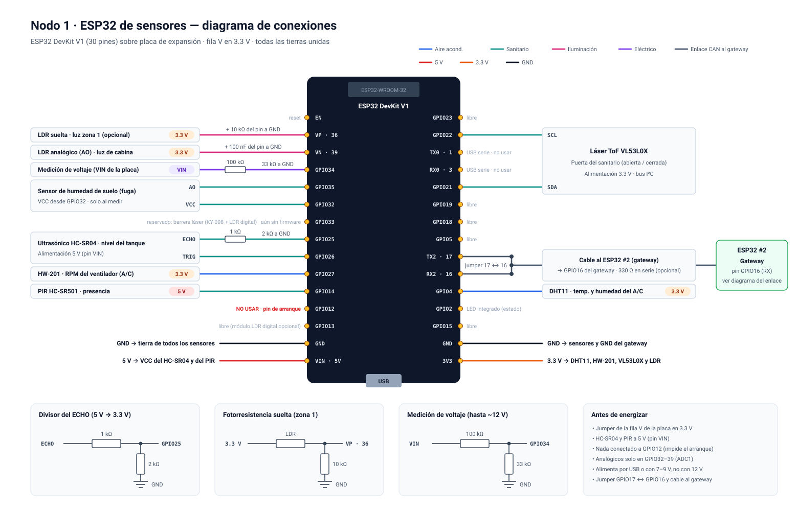

# Nodo 1 · ESP32 de sensores: dónde y cómo conectar



Son dos diagramas, también en PNG para mandarlos por celular:

- Este, con los sensores del nodo: [diagrama-nodo-sensores.png](diagrama-nodo-sensores.png).
- El del cable hacia el gateway: [diagrama-enlace-gateway.png](diagrama-enlace-gateway.png).

El nodo lee los sensores y transmite tramas CAN hacia el gateway. No tiene Wi-Fi ni Bluetooth, y **no se conecta al
CAN del autobús**. Eso cumple la segmentación y la no interferencia que pide Volvo.

## Materiales

- ESP32 DevKit V1 de 30 pines y su placa de expansión.
- Sensores: DHT11, HW-201, HC-SR04, VL53L0X, HC-SR501, módulo LDR analógico, sensor de humedad de suelo. Opcionales:
  LDR suelta y módulo LDR digital.
- Resistencias: 1 kΩ, 2 kΩ (o dos de 1 kΩ en serie), 100 kΩ y 33 kΩ; 10 kΩ y 330 Ω son opcionales.
- Capacitor cerámico de 100 nF en la salida analógica del LDR.
- Un jumper y 2 cables dupont para el enlace con el gateway.
- **No hace falta transceptor CAN** por ahora (ver «Enlace con el gateway»). Con los módulos SN65HVD230 el cableado
  cambia; está al final de este documento.

## Antes de conectar nada: la placa de expansión

1. **Jumper de la fila V en 3.3 V.** En muchas placas un solo jumper cambia la fila V de todos los pines. Si queda
   en 5 V, las salidas analógicas pueden pasar de 3.3 V y dañar la ESP32.
2. **El HC-SR04 y el PIR van a 5 V**, desde el pin VIN o el header de 5 V de la placa.
3. **Todas las tierras unidas**: sensores, ESP32 y la GND del gateway.
4. **Alimentación**: por USB o con 7–9 V en el conector. Con 12 V, el regulador lineal se calienta mucho.

## Tabla de conexiones

| Sensor | Pin del sensor → pin de la ESP32 | Alimentación | Notas |
|---|---|---|---|
| **DHT11** (A/C) | DATA → **GPIO4** | 3.3 V | El módulo de 3 pines ya trae la resistencia pull-up |
| **HW-201** (RPM del ventilador) | OUT → **GPIO27** | 3.3 V | A 1–3 cm de las aspas con una marca blanca; gira el potenciómetro hasta que el LED parpadee con cada vuelta |
| **HC-SR04** (nivel del tanque) | TRIG → **GPIO26** · ECHO → divisor → **GPIO25** | **5 V** | ECHO → 1 kΩ → GPIO25, y GPIO25 → 2 kΩ → GND |
| **VL53L0X** (puerta del sanitario) | SDA → **GPIO21** · SCL → **GPIO22** | 3.3 V | XSHUT y GPIO1 del módulo sin conectar |
| **HC-SR501** (presencia) | OUT → **GPIO14** | **5 V** | Su salida ya es de 3.3 V. Jumper en **H** (redisparo) y tiempo al mínimo |
| **Módulo LDR analógico** (luz de cabina) | AO → **GPIO39 (VN)** | 3.3 V | Capacitor de 100 nF entre AO y GND. Si al tapar el sensor sube la "luz", cambia `ZONA2_INVERTIDA` |
| **LDR suelta** (luz zona 1, opcional) | una pata a 3.3 V, la otra a **GPIO36 (VP)** | 3.3 V | Además, 10 kΩ de GPIO36 a GND |
| **Módulo LDR digital** (zona 3, opcional) | DO → **GPIO13** | 3.3 V | Si no se conecta, el tablero muestra la zona 3 siempre apagada. **No lo uses como receptor de la barrera láser** (ver abajo) |
| **Humedad de suelo** (fuga en el piso) | AO → **GPIO35** · VCC → **GPIO32** | desde GPIO32 | Se energiza solo al medir para que las pistas no se corroan |
| **Voltaje de alimentación** | VIN → 100 kΩ → **GPIO34** → 33 kΩ → GND | — | Mide la línea de 5 V (aguanta hasta ~12 V) |
| **Enlace con el gateway** | **jumper entre GPIO17 y GPIO16**; de GPIO17 un cable al **GPIO16 del gateway**; GND con GND | — | Sin transceptor. El GPIO17 del gateway no se conecta |

**Barrera láser (KY-008 + LDR digital):** el pin **GPIO33** queda reservado para el receptor, pero el firmware todavía
no lo lee. Pueden armarla en la maqueta; no aparecerá en el tablero hasta que se agregue al código. El KY-008 va a 3.3 V
y GND, y nunca debe apuntar a los ojos de nadie.

**No conectes nada a:**
- GPIO12: si está en alto al encender, la ESP32 no arranca.
- GPIO1 y GPIO3: son del USB serie.
- Pines ADC2 para analógico: no funcionan con Wi-Fi. Este nodo no usa Wi-Fi, pero así el cableado sirve si algún día cambia.

Pines libres para crecer: GPIO23, GPIO19, GPIO18, GPIO5 y GPIO15.

## Enlace con el gateway (CAN sin transceptor)

```
 ESP32 #1 (nodo, NO_ACK)                                   ESP32 #2 (gateway, LISTEN_ONLY)
 GPIO17 ──┬────────── [330 Ω opcional] ─────────────────►  GPIO16
 GPIO16 ──┘  (jumper entre 17 y 16)                        GPIO17   ✗ sin conectar
 GND ──────────────────────────────────────────────────── GND
```

- **Qué es:** las tramas son CAN reales (IDs, CRC, arbitraje); lo único distinto es la capa eléctrica. En vez del par
  diferencial CANH/CANL, la señal viaja a 3.3 V por un solo cable.
- **Por qué funciona:** el nodo transmite en modo `NO_ACK` y necesita leer su propia señal, por eso el jumper entre
  TX y RX. El gateway va en modo `LISTEN_ONLY`: solo recibe y no confirma nada.
- **Un solo sentido:** el gateway no tiene ningún cable por donde mandarle órdenes al nodo.
- **Cable corto:** de menos de 1 m. La señal de 3.3 V de un solo hilo no resiste ruido ni distancias largas.
- **El modo se elige en `firmware/platformio.ini`** con `-DSIN_TRANSCEPTOR=1` (viene activado). Los dos firmwares
  deben compilarse con el mismo modo.

**Con transceptores SN65HVD230 más adelante:** borra esa línea del `platformio.ini` y vuelve a subir los dos
firmwares. Cada ESP32 lleva su transceptor (CTX → GPIO17, CRX → GPIO16, 3.3 V y GND); CANH con CANH y CANL con CANL
entre los dos, con 120 Ω en cada extremo (casi todas las plaquitas ya la traen; entre CANH y CANL deben medirse ≈ 60 Ω
con todo apagado). Se quita el jumper 17 ↔ 16.

## Orden de armado y prueba

1. **Solo la ESP32 por USB.** Sube el firmware (`pio run -e nodo_sensores -t upload`) y abre el monitor a 115200
   baudios, con fin de línea "Nueva línea". Debe aparecer:
   ```
   [PRUEBA] Criptografía OK · trama D98F7BEA0001F8FC
   [CAN] Modo: SIN transceptor (nodo NO_ACK, gateway LISTEN_ONLY)
   ```
2. **Provisiona la clave.** Pega en el monitor `clave <64 hex>`. La clave sale de `python manage.py inicializar` o
   del botón *Rotar clave* del tablero. El nodo se reinicia y el LED pasa de parpadeo rápido a un destello cada 2 s.
3. **Conecta un sensor a la vez** y mira su línea en el monitor:
   ```
   [A/C] 23.4 °C · 55 %HR
   [SAN] Tanque: 152 mm → 54.8 %
   [SAN] Puerta: cerrada (41 mm) · presencia: sí · usos: 3
   [LUZ] Zona 1: 78 % · zona 2: 64 % · zona 3: encendida
   ```
4. **Conecta el enlace con el gateway** (jumper y los dos cables). En el gateway, el contador de tramas "recibidas"
   debe subir.
5. **Usa el comando `estado`** en el nodo en cualquier momento. Muestra la clave, el contador, las tramas enviadas y
   los errores del bus.

## Calibración (archivo `firmware/include/config_nodo.h`)

| Constante | Cómo obtenerla |
|---|---|
| `TANQUE_ALTURA_MM` | Distancia que imprime el nodo con el tanque **vacío** |
| `TANQUE_ZONA_MUERTA_MM` | Distancia con el tanque **lleno**. Debe ser de al menos 20–30 mm, porque el HC-SR04 no mide más cerca |
| `PUERTA_ABIERTA_MM` | Punto medio entre los mm que imprime con la puerta cerrada y con la puerta abierta |
| `MARCAS_POR_VUELTA` | 1 con una marca reflejante; si el HW-201 detecta cada aspa, pon el número de aspas |
| `SUELO_SECO_MV` / `SUELO_MOJADO_MV` | Lectura en seco y con las puntas en un trapo mojado |
| `ZONA2_INVERTIDA` | `true` si al tapar el módulo la lectura sube |

## Problemas comunes

| Síntoma | Causa probable | Solución |
|---|---|---|
| No se puede programar o no arranca | Algo conectado a GPIO12, o GPIO2 forzado en alto | Desconecta ese cable y vuelve a intentar |
| `DHT11 sin respuesta` | DATA mal conectado | Revisa GPIO4 y la alimentación de 3.3 V |
| `HC-SR04 sin eco` | Falta 5 V o el divisor está al revés | 1 kΩ del lado del ECHO y 2 kΩ hacia GND |
| `No se detectó el VL53L0X` | SDA y SCL invertidos | SDA → 21, SCL → 22 |
| Presencia "calentando" el primer minuto | El PIR se estabiliza al encender | Es normal; el nodo lo ignora 60 s |
| "fallidas" sube sin parar en el nodo | Sin transceptor: falta el jumper GPIO17 ↔ GPIO16. Con transceptor: nadie confirma (gateway apagado) o CANH/CANL mal | Revisa el jumper y que ambos firmwares usen el mismo modo |
| El gateway no recibe tramas | El cable va al GPIO17 del gateway en vez del 16, falta la GND común o los firmwares tienen modos distintos | Sigue la lista del diagrama del enlace |
| Lecturas analógicas fijas en 0 o en 3300 mV | Sensor alimentado a 5 V, o pin equivocado | Fila V en 3.3 V y los pines de la tabla |
